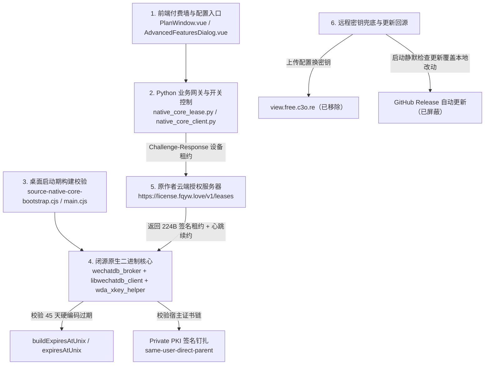

# 商业化控制思路分析与纯开源替代架构说明

> 本文档整理并沉淀两部分内容：  
> 1. **原作者商业化控制与防滥用架构思路拆解**（基于本仓库真实代码与清单一比一梳理，方便后续如需做商业化/可控分发时参考借鉴）；  
> 2. **本项目纯开源本地化替代架构**（如何摆脱过期闭源组件与远端授权服务器，实现纯本地低延迟实时同步，以及明确的功能边界）。

---

## 一、 原作者的“商业化控制与防二次分发”核心思路拆解

原作者虽然放出了 Python/Vue 源码，但真正决定“软件能不能长期使用、高级功能谁能用、第三方能否直接改源码打包转卖”的关键能力，全部通过以下 **7 层控制体系** 锁定在作者手里：

### 1.1 “核心能力闭源化 + 胶水层开源”架构（最核心一招）
- **开源部分**：UI 展示（`frontend/`）、API 路由与业务编排（FastAPI）、聊天导出逻辑。即使别人拿到完整仓库源码，也能看到所有交互设计。
- **闭源原生核心**：把最关键、最难替代的两个能力编译成预编译二进制，**不提供 C/C++ 源码**：
  1. **实时读库引擎**：`wechatdb_broker`（macOS）/ `wechatdb_broker.exe`（Windows）+ 客户端动态库 `libwechatdb_client.dylib` / `wechatdb_client.dll`，负责以只读句柄实时访问微信加锁中的 SQLCipher 4 + WAL 数据库。
  2. **便捷提取/加解密组件**：macOS 密钥辅助 `wda_xkey_helper`、Windows 图片辅助与写库触发器 `wcdb_api.dll` / `img_helper.dll`。
- **借鉴点**：如果未来自己做商业版，可以把**最核心的协议层、写库能力或高价值 AI/自动化调度引擎**封装为独立原生进程/服务或受控二进制接口，业务外壳保持清晰可迭代。

### 1.2 构建期 45 天强定时生命周期（`45 * 24 * 60 * 60`）
- 在 `wechatdb_native_build.json`（原生核心清单）和 `wda_xkey_build.json`（密钥组件清单）以及 `macos_db_key_helper.py`、`desktop/src/source-native-core-bootstrap.cjs` 中，**原生二进制内部与签名清单同时写死了构建有效期**：
  - 例如本次排查中看到的：macOS 版 `wechatdb_native_build.json` 到期时间戳为 `1790145553`（`2026-09-23`），Windows 版到期时间戳为 `1792680288`（`2026-10-22`），`wda_xkey_helper` 到期时间戳为 `1790146461`（`2026-09-23`）。
- **双端校验**：就算把 Python 侧的时间校验注释掉，**闭源二进制 `wechatdb_broker` / `wda_xkey_helper` 自己内部同样会检查系统时间与授权状态**，一旦过期就直接返回状态码拒绝服务（例如 `BUILD_MISMATCH` / `LICENSE_REQUIRED` / 退出码 `20`）。
- **设计目的**：防止源码版、测试版或老版本无限期流传，逼迫使用者定期回作者仓库/官网更新或续期。

### 1.3 云端设备租约与 Challenge-Response 授权（`native_core_lease.py`）
- 当闭源原生核心没有本地有效租约时，要求向作者服务器 `https://license.fqyw.love/v1/leases` 请求 **224 字节加密租约（Lease）**：
  - 流程：`Client -> 取设备指纹与 buildId -> 向服务端拿随机 challenge -> 用本地设备凭证签名 -> 服务端下发带过期时间与功能位掩码（FeatureBits）的 224B 租约 -> client.install_lease(lease)`。
  - 同时后台原设计有 1 小时定时心跳（`_HEARTBEAT_INTERVAL_SECONDS = 3600`），如果服务端返回 4xx 拒绝（`_is_authoritative_rejection`），客户端会直接删除本地缓存凭证并停止运行 `stop_native_core_broker(_force=True)`。
- **借鉴点**：通过 `FeatureBits` 位掩码控制“免费版仅开 `DATABASE_READ`，付费版才解锁导出/高级动作/ASR”，而且即便在客户端断网时，也可以允许短时缓存租约（Grace Period），超时或被吊销再锁死，体验比“每次操作都联网验证”更好。

### 1.4 宿主签名链钉扎（Code Signature Pinning & `same-user-direct-parent`）
- 在 `wechatdb_native_build.json` 与 `macos_db_key_helper.py` 中，原作者使用了自建 Private PKI 证书链校验：
  - `macosClientSignerSha256`、`macosBrokerSignerSha256`、`macosHostSignerSha256`、`macosPrivateRootSha256`（Windows 上对应 `windowsClientSignerSha256`、`windowsBrokerSignerSha256`）。
- **核心作用**：
  1. 防止第三方开发者拿原作者的预编译二进制 `wda_xkey_helper` / `wechatdb_broker`，随便套一个自己打包的 Python/Electron 外壳或改写 UI 去售卖——只要宿主进程签名 SHA-256 不是作者私钥签署的宿主，原生组件直接拒绝连接并返回 `HELPER_INTEGRITY_FAILURE`。
  2. 原作者自己用 CI/发布密钥打包的官方包才有合法宿主签名。

### 1.5 UI 付费墙、兑换码与后端功能开关
- `frontend/components/PlanWindow.vue`、`AdvancedFeaturesDialog.vue` 负责展示方案与激活码兑换；
- 部分闭源功能（如主动发消息、修改/补录记录、朋友圈跟圈等写操作）在开源端刻意保留为空白/只读桩代码（`databaseWriteBuild: false`, `readOnlyBuild: true`, `wechatActions: []`），真正能写的版本只存在于闭源商业版中。

### 1.6 启动静默更新覆盖（防长期分叉）
- 原版桌面壳 `desktop/src/main.cjs` 启动时会检查 GitHub Release 最新版本；如果用户未关闭自动更新，官方新版包下载安装后可能直接覆盖本地修改过的源码或配置。

### 1.7 云端辅助回退通道（`view.free.c3o.re` 等）
- 当早期本地算法没提取到密钥时，通过上传本地配置到第三方中转服务来返回解析结果；一旦该服务下线或按账号限流/收费，依赖云端回退的版本就会同步失效。（同时存在用户隐私与配置文件外泄风险。）

---

## 二、 本项目纯开源本地化改造与边界清单

为彻底保证本项目 **100% 纯本地离线运行、不受任何 45 天有效期和外网授权服务器中断影响**，已完成以下替换与禁用约束：

### 2.1 已彻底移除 / 禁止的外部控制链路（今后继续禁止引入）
1. **禁止上传任何本地配置到外部服务器**：`key_service.py` 中的 `fetch_and_save_remote_keys` 已彻底屏蔽向 `view.free.c3o.re` 发送 `global_config`，且 `cdn_image_service.py` 已去除失效的外部 `wxcdn.c3o.re` 依赖。
2. **禁止启动自动更新覆盖**：`desktop/src/main.cjs` 已屏蔽启动自动检查更新。
3. **移除前端商业付费弹窗与源码 45 天引导锁**：清理 `PlanWindow.vue`、`AdvancedFeaturesDialog.vue`、`source-native-core-bootstrap.cjs` 中的限时/付费拦截。

### 2.2 核心能力纯开源本地化替代方案

| 能力模块 | 原作者闭源/受控方案 | 本项目当前纯开源本地替代方案 | 状态 |
| :--- | :--- | :--- | :--- |
| **macOS 数据库密钥提取** | `wda_xkey_helper`（2026-09-23 到期 + 宿主私钥钉扎） | 开源自研 C 原生硬件断点捕获 [wcdb_native_capture.c](file:///Users/li/Downloads/03_%E5%BC%80%E6%BA%90%E9%A1%B9%E7%9B%AE/01%E9%AB%98%E4%BB%BF%E5%BE%AE%E4%BF%A1WeChatDataAnalysis-main/src/wechat_decrypt_tool/native/macos/source/wcdb_native_capture.c) + [macos_clone_capture.py](file:///Users/li/Downloads/03_%E5%BC%80%E6%BA%90%E9%A1%B9%E7%9B%AE/01%E9%AB%98%E4%BB%BF%E5%BE%AE%E4%BF%A1WeChatDataAnalysis-main/src/wechat_decrypt_tool/macos_clone_capture.py)（LLDB 备选），支持跨核心登录库校验 256000 轮主口令 | ✅ 已打通可用 |
| **图片密钥提取** | 内存扫描 / 云端解析 | WeFlow 纯本地算法派生 + V2 图片模板验真（无需注入微信内存） | ✅ 已打通可用 |
| **实时读取消息 / 会话 / 联系人 / 朋友圈** | 闭源 `wechatdb_broker` + `https://license.fqyw.love/v1/leases`（Mac 2026-09-23 到期 / Win 2026-10-22 到期） | 自研 [local_sqlite_realtime.py](file:///Users/li/Downloads/03_%E5%BC%80%E6%BA%90%E9%A1%B9%E7%9B%AE/01%E9%AB%98%E4%BB%BF%E5%BE%AE%E4%BF%A1WeChatDataAnalysis-main/src/wechat_decrypt_tool/local_sqlite_realtime.py) + [native_core_realtime.py](file:///Users/li/Downloads/03_%E5%BC%80%E6%BA%90%E9%A1%B9%E7%9B%AE/01%E9%AB%98%E4%BB%BF%E5%BE%AE%E4%BF%A1WeChatDataAnalysis-main/src/wechat_decrypt_tool/native_core_realtime.py)：基于 SQLCipher 4 解密 + SQLite WAL 预写日志增量合成 + 标准 `sqlite3` 只读查询 | ✅ 已实现（Mac/Win 通用） |
| **防撤回触发器状态查看** | 闭源 `wechatdb_broker` 读库 | 自动走 `local_sqlite_realtime.py` 开源实时读库，正常刷新显示所有会话与触发器状态 | ✅ 可正常查看 |
| **防撤回触发器安装/卸载** | Windows 专用闭源 DLL `wcdb_api.dll`（向微信实时库写入 `CREATE TRIGGER`） | Windows 保留 `wcdb_api.dll` 兼容；macOS 通过自研 [macos_anti_revoke.py](file:///Users/li/Downloads/03_%E5%BC%80%E6%BA%90%E9%A1%B9%E7%9B%AE/01%E9%AB%98%E4%BB%BF%E5%BE%AE%E4%BF%A1WeChatDataAnalysis-main/src/wechat_decrypt_tool/macos_anti_revoke.py) 纯 Python 实现：检测退出微信后先自动备份、再解密合并 WAL、写入 `anti_revoke_capture_delete_*` / `anti_revoke_block_insert_*` 触发器、验真并重加密回写 | ✅ 双端均可安装（Mac 需先退出微信） |

### 2.3 纯 Python SQLCipher + WAL 实时引擎工作原理（`local_sqlite_realtime.py`）
1. **零绕过、纯开源只读**：当 `native_core_realtime._query` 检测到闭源 `wechatdb_broker` 清单已过期、返回未授权状态或离线无法连接 `license.fqyw.love` 时，自动切换并锁定到 `LOCAL_SQLCIPHER_READER`（可通过环境变量 `WECHAT_TOOL_LOCAL_SQLCIPHER_REALTIME=0` 手动关闭）。
2. **主库快照 + WAL 帧级增量覆盖**：
   - 利用项目已有的每库 32 字节派生原始密钥缓存（`native_core_raw_key_cache`），免去重复 256,000 轮 PBKDF2 计算；
   - 仅当主 `.db` 的 `(mtime_ns, size)` 变化时才重建基础明文快照（`.base.db`）；
   - 当微信收到新消息但尚未 checkpoint 到主库（仅修改 `.db-wal`）时，引擎按标准 SQLite WAL 帧头格式校验滚动校验和（`0x377f0682` / `0x377f0683`）与 `salt1/salt2`，定位所有已提交事务帧，通过 macOS APFS CoW（`clonefile`）/ 复制主快照后**仅解密并覆写发生变化的页**，原子切换为 `.live.db` 后用 Python 内置 `sqlite3` 只读查询；
   - 若 `.db` 与 `.db-wal` 均未变化，直接零拷贝命中缓存打开查询，耗时在毫秒级。

---

## 三、 今后维护与商业化扩展建议

- **如果你想保留“绝对永久免费、纯本地离线使用”**：
  - 每次引入第三方预编译二进制（`.dll` / `.dylib` / `.exe` / 无源码可执行文件）前，务必按 [开发维护手册.md](file:///Users/li/Downloads/03_%E5%BC%80%E6%BA%90%E9%A1%B9%E7%9B%AE/01%E9%AB%98%E4%BB%BF%E5%BE%AE%E4%BF%A1WeChatDataAnalysis-main/%E5%BC%80%E5%8F%91%E7%BB%B4%E6%8A%A4%E6%89%8B%E5%86%8C.md) 检查清单中的 `buildExpiresAtUnix` 与外连域名，**禁止把任何核心主链路强绑定在第三方闭源二进制或在线租约接口上**。
- **如果未来你要为外部客户提供付费分发版**：
  - 可以直接在客户端外壳与高阶工作流（而非基础只读解析核心）之上，参考原作者第 1 章的 **“核心扩展闭源编译 + 宿主签名绑定 + 带离线宽限期的 Challenge-Response 设备租约 + FeatureBits 分级授权”** 模型独立实现你自己的授权服务端与签名证书体系。
