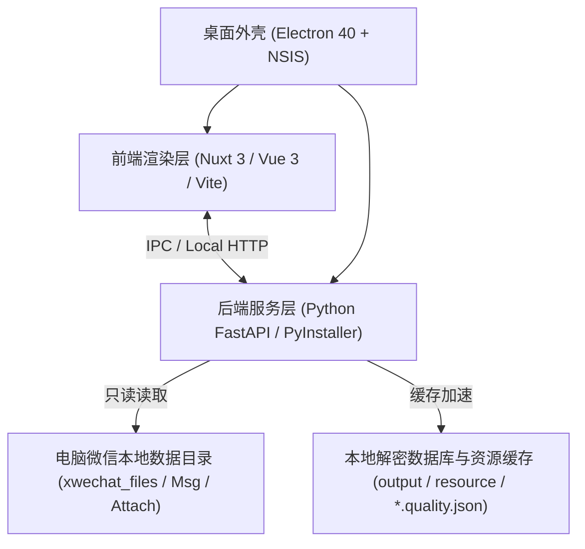

# WeChatDataAnalysis-HD 开发与维护全景手册

> **项目工作区路径**：`D:\03_开源项目\01高仿微信WeChatDataAnalysis-main`  
> **适用对象**：后续接手本项目的人类开发者、技术维护人员及 AI 助手（如 Antigravity / Claude / GPT 等）。  
> **核心原则**：**严格遵守微信安全风控边界——100% 本地磁盘只读解析，绝不注入 DLL、绝不 Hook 微信内存、绝不伪造腾讯网络请求，杜绝封号风险。**

---

## 目录
1. [系统整体架构与技术栈](#一系统整体架构与技术栈)
2. [微信图片存储与高清大图技术机制深度剖析](#二微信图片存储与高清大图技术机制深度剖析)
3. [“退出定位”视口保持与双向滚动加载机制](#三退出定位视口保持与双向滚动加载机制)
4. [图片全屏预览键盘导航机制](#四图片全屏预览键盘导航机制)
5. [核心改动代码索引与位置](#五核心改动代码索引与位置)
6. [自动化测试与构建发布速查手册](#六自动化测试与构建发布速查手册)

---

## 一、 系统整体架构与技术栈

本项目是一套高保真高仿微信客户端、兼具离线解密、分析与增量导出能力的跨平台桌面应用：



* **前端层 (`frontend/`)**：Nuxt 3 (SSR 静态导出 / SPA 模式) + Vue 3 + Tailwind CSS + Pinia。
  - `components/chat/`：聊天界面、气泡、输入栏、媒体弹窗、横幅定位等组件。
  - `composables/chat/`：聊天逻辑组合函数（`useChatMessages.js`、`useChatSearch.js`、`useChatExport.js` 等）。
* **后端层 (`src/wechat_decrypt_tool/`)**：Python 3.11 + FastAPI。
  - `routers/chat_media.py`：聊天图片、视频、表情、语音等媒体的高性能加解密与按需流式读取。
  - `export_images.py` & `image_quality.py`：智能大图探测、变体评分与原子缓存升级机制。
* **桌面外壳 (`desktop/`)**：Electron + `electron-builder` + NSIS 安装器。
  - 二进制后端由 PyInstaller 打包为单文件/冻结目录 `wechat-backend.exe`，完全脱离 Python 环境运行。

---

## 二、 微信图片存储与高清大图技术机制深度剖析

### 1. 微信客户端底层落盘原理
微信（Windows 桌面端）对聊天图片的传输与存储有严格的分级策略：
1. **未点开的图片（缩略图）**：
   - 当他人发送图片时，微信桌面端**默认只在后台下载缩略图**（带 `_t.dat`，分辨率通常在 150×50 到 200×200 之间，体积仅数 KB 到十数 KB）；
   - 微信此举是为了节约磁盘空间和流量，此时电脑本地磁盘上**根本不存在原始高清大图**。
2. **点开过的图片（高清大图/原图）**：
   - 只有当用户在微信客户端中**单击打开过该图片**，微信客户端才会通过内部专属加密通道（腾讯私有 MMTLS 协议）向微信服务器拉取原图；
   - 微信下载完成后，会保存在当前微信登录账号的会话目录：  
     `xwechat_files/<wxid>/msg/attach/<chat_hash>/<year-month>/Img/<md5>.dat`（注意：**文件名没有 `_t`**，分辨率可达 1441×425、4K 乃至发送者的原图）。

### 2. 为什么必须“在电脑微信中先点开一次”？
* **风控与反封号红线**：
  - 聊天记录 XML 中的 `cdnbigimgurl`、`aeskey` 无法通过普通 HTTP/HTTPS 匿名访问腾讯 CDN，必须绑定当前微信客户端登录态 Session 和 Token；
  - 任何试图注入微信内存、Hook 网络模块或者在第三方软件中伪造微信登录态直接调用腾讯服务器的行为，均会触发腾讯的异常设备与协议风控机制，导致微信账号被临时或永久封号；
  - 原作者早期曾搭建过一个云端 Worker（`https://wxcdn.c3o.re`）试图中转下载，但该外部服务早已彻底失效（404），且会造成客户端长达几十秒的网络阻塞与红字报错。
* **安全结论**：
  - 本项目坚决采用**100% 纯本地只读磁盘解析**，与原作者稳定运行的风控策略完全一致；
  - 用户只需在电脑微信上点开过图片，微信便会自动把高清图存入磁盘；而我们的软件端在浏览时就会**毫秒级自动扫描并无缝升级为超清大图**，既做到无感高清，又彻底杜绝封号危险。

### 3. 后端自动升级实现逻辑 (`chat_media.py`)
* 当前端请求图片时，后端执行以下优先逻辑：
  1. **检查缓存是否已知为大图**：读取缓存旁的 `.quality.json`，若 `thumbnail === false`，则直接毫秒级返回已有缓存；
  2. **深入微信目录秒级探测**：调用 `select_export_image`，扫描微信会话 Attach 目录；
  3. **质量评分判定**：对比当前缓存与扫描候选的 `image_payload_score(width * height, bytes)`；
  4. **原子缓存替换**：一旦在本地发现更高质量图片，调用 `cache_export_image` 原子写入 `resource/` 目录，并更新 `.quality.json`；
  5. **平滑降级**：若微信本地尚未下载大图，则平滑返回已有的缩略图，不再抛出 404，也不发起失效的外部网络请求。

---

## 三、 “退出定位”视口保持与双向滚动加载机制

### 1. 原有问题根因
* 用户点击“从第一条消息开始阅读”后，系统进入 Context 定位模式并拉取首条消息；
* 此时顶部会出现浅绿色横幅提示。点击“退出定位”时，原代码执行了：
  ```javascript
  allMessages.value = { ...allMessages.value, [u]: saved }
  ```
  强行将消息列表回滚回进入定位前的最后截存（即最新消息），导致视口瞬间跳走。
* 更有甚者，默认模式假定视口在最新消息，**只支持向上拉取历史（`loadMoreMessages`），根本不支持向下加载更新消息**。若单纯清除退出代码，用户滑到底部也会卡住无法继续阅读。

### 2. 修复方案 (`useChatSearch.js` & `ConversationPane.vue`)
1. **语义解耦**：
   - **“退出定位”**：仅将 `searchContext.bannerDismissed` 设为 `true`，清除顶部横幅与高亮；当前消息列表完全不动，并且保持 `active: true`，继续启用 `loadMoreSearchContextAfter` 向下滚动拉取能力；
   - **“返回最新”**：新增专门的 `returnToLatestMessages` 动作，仅当用户主动点击右上角/横幅中的“返回最新”按钮或切换会话时，才重置回最新消息列表。
2. **前后端配合**：
   - `searchContextBannerText`：在 `bannerDismissed: true` 时返回空字符串，精准隐藏横幅。

---

## 四、 图片全屏预览键盘导航机制

### 1. 需求与体验设计
* 在单聊或群聊中点击任意图片，弹出全屏预览弹窗；
* 用户不仅可以使用鼠标点击左右两边的圆形切换按钮，还可以像常见专业看图软件一样，通过键盘方向键进行无缝图片浏览：
  - **`ArrowRight`（向右方向键） / `ArrowDown`（向下方向键）**：切换到**下一张**图片；
  - **`ArrowLeft`（向左方向键） / `ArrowUp`（向上方向键）**：切换到**上一张**图片；
  - **`Escape`**：退出全屏图片预览；
  - **滚轮**：缩放图片；**双击**：重置缩放与旋转。

### 2. 核心实现位置
* `frontend/pages/chat/[[username]].vue`：
  - 从 `useChatMessages` 解构出 `showPrevPreviewImage`、`showNextPreviewImage`；
  - 在全局按键监听 `onGlobalKeyDown` 中拦截方向键：
    ```javascript
    if (previewImageUrl.value) {
      if (key === 'ArrowLeft' || key === 'ArrowUp') {
        event.preventDefault()
        showPrevPreviewImage()
        return
      }
      if (key === 'ArrowRight' || key === 'ArrowDown') {
        event.preventDefault()
        showNextPreviewImage()
        return
      }
    }
    ```
* `frontend/components/chat/ChatOverlays.vue`：
  - 更新弹窗外层与左右按钮的 `title` 提示信息，明确标注方向键快捷操作（例如 `上一张 (也可按 ← 或 ↑ 方向键)`）。
  - 组件内部 `watch(previewImageUrl)` 在切换时自动重置旋转与缩放角度。

---

## 五、 核心改动代码索引与位置

| 功能模块 | 文件路径 | 核心修改点 |
| :--- | :--- | :--- |
| **退出定位与双向滚动** | `frontend/composables/chat/useChatSearch.js` | `exitSearchContext` 仅隐藏横幅保留消息流；新增并导出 `returnToLatestMessages` |
| **退出定位横幅组件** | `frontend/components/chat/ConversationPane.vue` | 横幅判断增加 `!searchContext.bannerDismissed`；“返回最新”触发重置 |
| **大图自动升级与后端降级** | `src/wechat_decrypt_tool/routers/chat_media.py` | `get_chat_image` 引入 `select_export_image`；本地探测 HD 大图并原子更新缓存；去除无效云端重试 |
| **前端去干扰优化** | `frontend/composables/chat/useChatMessages.js` | `shouldShowImageLargeReload = () => false`，移去手动重试按钮与红字 404 |
| **预览键盘导航** | `frontend/pages/chat/[[username]].vue` | `onGlobalKeyDown` 支持 `ArrowLeft` / `ArrowRight` / `ArrowUp` / `ArrowDown` 快速切图 |
| **预览浮层提示** | `frontend/components/chat/ChatOverlays.vue` | 浮层与按钮增加键盘方向键快捷提示 |
| **自动化测试用例** | `frontend/tests/chat-image-preview-keyboard.test.js` | 验证左右上下方向键循环切图逻辑 |
| **自动化测试用例** | `tests/test_chat_media_image_cache_upgrade.py` | 验证本地会话目录大图自动升级、`.quality.json` 持久化与离线降级 |

---

## 六、 自动化测试与构建发布速查手册

### 1. 运行自动化测试
```bash
# 1. 运行前端全套测试 (当前包含 68 个 Node 测试 + 384 个 Vitest 测试)
npm --prefix frontend test

# 2. 运行后端全套媒体与导出测试 (36 项 Pytest 测试)
.build-venv\Scripts\python.exe -m pytest tests/test_chat_media_image_cache_upgrade.py tests/test_export_images_quality.py tests/test_chat_incremental_export.py
```

### 2. 独立 Windows 安装包打包命令
```powershell
# 执行端到端完整打包 (输出至项目根目录与 desktop/dist/)
powershell -ExecutionPolicy Bypass -File desktop/scripts/build-local-hd.ps1 -NativeResources "D:\开源项目\WeChatDataAnalysis\resources" -SkipDependencies
```
* **打包产物**：`WeChatDataAnalysis-2.6.0-HD2-Setup.exe`
* **目标安装位置**：用户自定义（如 `D:\自己开发WeChatDataAnalysis-main\WeChatDataAnalysis-HD`）
* **用户数据保护**：用户解密的聊天数据库和导出内容存放于 `AppData\Roaming\wechat-data-analysis-hd`，安装包已开启 `deleteAppDataOnUninstall: false`，覆盖安装或卸载均不会丢失任何已分析的聊天数据。
