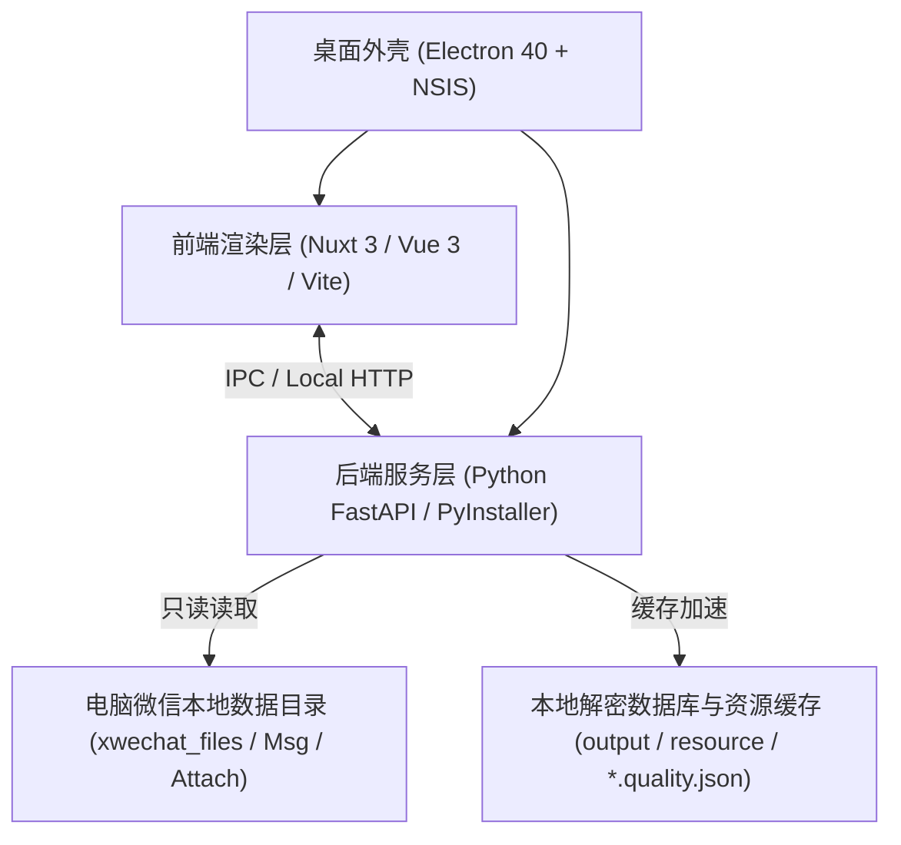

# WeChatDataAnalysis-HD 开发与维护全景手册

> **项目工作区路径**：`D:\03_开源项目\01高仿微信WeChatDataAnalysis-main`  
> **适用对象**：后续接手本项目的人类开发者、技术维护人员及 AI 助手（如 Antigravity / Claude / GPT 等）。  
> **核心原则**：**严格遵守微信安全风控边界——100% 本地磁盘只读解析，绝不注入 DLL、绝不 Hook 微信内存、绝不伪造腾讯网络请求，杜绝封号风险。**

---

## 目录
1. [系统整体架构与技术栈](#一系统整体架构与技术栈)
2. [微信图片存储与高清大图技术机制深度剖析](#二微信图片存储与高清大图技术机制深度剖析)
3. [“退出定位”视口保持与双向滚动加载机制](#三退出定位视口保持与双向滚动加载机制)
4. [图片全屏预览键盘导航机制](#四图片全屏预览键盘导航机制)
5. [核心改动代码索引与位置](#五核心改动代码索引与位置)
6. [自动化测试与构建发布速查手册](#六自动化测试与构建发布速查手册)

---

## 一、 系统整体架构与技术栈

本项目是一套高保真高仿微信客户端、兼具离线解密、分析与增量导出能力的跨平台桌面应用：



* **前端层 (`frontend/`)**：Nuxt 3 (SSR 静态导出 / SPA 模式) + Vue 3 + Tailwind CSS + Pinia。
  - `components/chat/`：聊天界面、气泡、输入栏、媒体弹窗、横幅定位等组件。
  - `composables/chat/`：聊天逻辑组合函数（`useChatMessages.js`、`useChatSearch.js`、`useChatExport.js` 等）。
* **后端层 (`src/wechat_decrypt_tool/`)**：Python 3.11 + FastAPI。
  - `routers/chat_media.py`：聊天图片、视频、表情、语音等媒体的高性能加解密与按需流式读取。
  - `export_images.py` & `image_quality.py`：智能大图探测、变体评分与原子缓存升级机制。
* **桌面外壳 (`desktop/`)**：Electron + `electron-builder` + NSIS 安装器。
  - 二进制后端由 PyInstaller 打包为单文件/冻结目录 `wechat-backend.exe`，完全脱离 Python 环境运行。

---

## 二、 微信图片存储与高清大图技术机制深度剖析

### 1. 微信客户端底层落盘原理
微信（Windows 桌面端）对聊天图片的传输与存储有严格的分级策略：
1. **未点开的图片（缩略图）**：
   - 当他人发送图片时，微信桌面端**默认只在后台下载缩略图**（带 `_t.dat`，分辨率通常在 150×50 到 200×200 之间，体积仅数 KB 到十数 KB）；
   - 微信此举是为了节约磁盘空间和流量，此时电脑本地磁盘上**根本不存在原始高清大图**。
2. **点开过的图片（高清大图/原图）**：
   - 只有当用户在微信客户端中**单击打开过该图片**，微信客户端才会通过内部专属加密通道（腾讯私有 MMTLS 协议）向微信服务器拉取原图；
   - 微信下载完成后，会保存在当前微信登录账号的会话目录：  
     `xwechat_files/<wxid>/msg/attach/<chat_hash>/<year-month>/Img/<md5>.dat`（注意：**文件名没有 `_t`**，分辨率可达 1441×425、4K 乃至发送者的原图）。

### 2. 为什么必须“在电脑微信中先点开一次”？
* **风控与反封号红线**：
  - 聊天记录 XML 中的 `cdnbigimgurl`、`aeskey` 无法通过普通 HTTP/HTTPS 匿名访问腾讯 CDN，必须绑定当前微信客户端登录态 Session 和 Token；
  - 任何试图注入微信内存、Hook 网络模块或者在第三方软件中伪造微信登录态直接调用腾讯服务器的行为，均会触发腾讯的异常设备与协议风控机制，导致微信账号被临时或永久封号；
  - 原作者早期曾搭建过一个云端 Worker（`https://wxcdn.c3o.re`）试图中转下载，但该外部服务早已彻底失效（404），且会造成客户端长达几十秒的网络阻塞与红字报错。
* **安全结论**：
  - 本项目坚决采用**100% 纯本地只读磁盘解析**，与原作者稳定运行的风控策略完全一致；
  - 用户只需在电脑微信上点开过图片，微信便会自动把高清图存入磁盘；而我们的软件端在浏览时就会**毫秒级自动扫描并无缝升级为超清大图**，既做到无感高清，又彻底杜绝封号危险。

### 3. 后端自动升级实现逻辑 (`chat_media.py`)
* 当前端请求图片时，后端执行以下优先逻辑：
  1. **检查缓存是否已知为大图**：读取缓存旁的 `.quality.json`，若 `thumbnail === false`，则直接毫秒级返回已有缓存；
  2. **深入微信目录秒级探测**：调用 `select_export_image`，扫描微信会话 Attach 目录；
  3. **质量评分判定**：对比当前缓存与扫描候选的 `image_payload_score(width * height, bytes)`；
  4. **原子缓存替换**：一旦在本地发现更高质量图片，调用 `cache_export_image` 原子写入 `resource/` 目录，并更新 `.quality.json`；
  5. **平滑降级**：若微信本地尚未下载大图，则平滑返回已有的缩略图，不再抛出 404，也不发起失效的外部网络请求。

---

## 三、 “退出定位”视口保持与双向滚动加载机制

### 1. 原有问题根因
* 用户点击“从第一条消息开始阅读”后，系统进入 Context 定位模式并拉取首条消息；
* 此时顶部会出现浅绿色横幅提示。点击“退出定位”时，原代码执行了：
  ```javascript
  allMessages.value = { ...allMessages.value, [u]: saved }
  ```
  强行将消息列表回滚回进入定位前的最后截存（即最新消息），导致视口瞬间跳走。
* 更有甚者，默认模式假定视口在最新消息，**只支持向上拉取历史（`loadMoreMessages`），根本不支持向下加载更新消息**。若单纯清除退出代码，用户滑到底部也会卡住无法继续阅读。

### 2. 修复方案 (`useChatSearch.js` & `ConversationPane.vue`)
1. **语义解耦**：
   - **“退出定位”**：仅将 `searchContext.bannerDismissed` 设为 `true`，清除顶部横幅与高亮；当前消息列表完全不动，并且保持 `active: true`，继续启用 `loadMoreSearchContextAfter` 向下滚动拉取能力；
   - **“返回最新”**：新增专门的 `returnToLatestMessages` 动作，仅当用户主动点击右上角/横幅中的“返回最新”按钮或切换会话时，才重置回最新消息列表。
2. **前后端配合**：
   - `searchContextBannerText`：在 `bannerDismissed: true` 时返回空字符串，精准隐藏横幅。

---

## 四、 图片全屏预览键盘导航机制

### 1. 需求与体验设计
* 在单聊或群聊中点击任意图片，弹出全屏预览弹窗；
* 用户不仅可以使用鼠标点击左右两边的圆形切换按钮，还可以像常见专业看图软件一样，通过键盘方向键进行无缝图片浏览：
  - **`ArrowRight`（向右方向键） / `ArrowDown`（向下方向键）**：切换到**下一张**图片；
  - **`ArrowLeft`（向左方向键） / `ArrowUp`（向上方向键）**：切换到**上一张**图片；
  - **`Escape`**：退出全屏图片预览；
  - **滚轮**：缩放图片；**双击**：重置缩放与旋转。

### 2. 核心实现位置
* `frontend/pages/chat/[[username]].vue`：
  - 从 `useChatMessages` 解构出 `showPrevPreviewImage`、`showNextPreviewImage`；
  - 在全局按键监听 `onGlobalKeyDown` 中拦截方向键：
    ```javascript
    if (previewImageUrl.value) {
      if (key === 'ArrowLeft' || key === 'ArrowUp') {
        event.preventDefault()
        showPrevPreviewImage()
        return
      }
      if (key === 'ArrowRight' || key === 'ArrowDown') {
        event.preventDefault()
        showNextPreviewImage()
        return
      }
    }
    ```
* `frontend/components/chat/ChatOverlays.vue`：
  - 更新弹窗外层与左右按钮的 `title` 提示信息，明确标注方向键快捷操作（例如 `上一张 (也可按 ← 或 ↑ 方向键)`）。
  - 组件内部 `watch(previewImageUrl)` 在切换时自动重置旋转与缩放角度。

### 3. 朋友圈图片全屏预览键盘导航 (`frontend/pages/sns.vue`)
* **多视图统一支持**：无论是查看某个具体联系人的朋友圈，还是查看“全部”好友的朋友圈，只要全屏点开图片，均能使用方向键连续切图浏览。
* **数据流与图片扁平化 (`snsPreviewImageItems`)**：
  - 遍历当前视口已加载的 `posts.value`，提取所有非视频（过滤 `type === 6`）媒体项，构建连续图片线性序列 `{ post, media, idx }`。
  - 支持单帖子多图连看，以及在不同帖子之间自动平滑跨帖过渡。
* **当前定位与切换 (`switchSnsPreviewImage`)**：
  - 依据 `previewCtx.value` 精确匹配发帖 ID 与媒体序号，计算 `currentSnsPreviewIndex`；
  - 方向键左/上 (`ArrowLeft` / `ArrowUp`) 切换至上一张，方向键右/下 (`ArrowRight` / `ArrowDown`) 切换至下一张；
  - 采用无缝循环取模算法；当向后连续浏览至末尾附近（倒数 3 张以内）且有更多数据时，后台自动静默拉取下一页朋友圈 (`loadPosts({ reset: false })`)；
  - 切换时重置图片缩放和实况照片状态，并自动拉取高解析度原图。
* **UI 交互增强**：
  - 弹窗左右两侧加入圆形半透明切换悬浮按钮；
  - 弹窗左上角展示发帖人昵称与当前进度指示器（如 `张三  1 / 9`）；
  - 底部缩放工具栏中央集成图片计数指示（如 `3 / 24`）。

---

## 五、 核心改动代码索引与位置

| 功能模块 | 文件路径 | 核心修改点 |
| :--- | :--- | :--- |
| **退出定位与双向滚动** | `frontend/composables/chat/useChatSearch.js` | `exitSearchContext` 仅隐藏横幅保留消息流；新增并导出 `returnToLatestMessages` |
| **退出定位横幅组件** | `frontend/components/chat/ConversationPane.vue` | 横幅判断增加 `!searchContext.bannerDismissed`；“返回最新”触发重置 |
| **大图自动升级与后端降级** | `src/wechat_decrypt_tool/routers/chat_media.py` | `get_chat_image` 引入 `select_export_image`；本地探测 HD 大图并原子更新缓存；去除无效云端重试 |
| **资源侧栏全量自加载** | `frontend/composables/chat/useChatMessages.js` & `ResourceSidebar.vue` | 递归自动链式拉取全部图片视频资源，自适应展开，移除按年限制并增加加载进度 |
| **防撤回核心服务** | `src/wechat_decrypt_tool/anti_revoke_service.py` | 极速触发器检测、NTFS 目录桥接、`WeFlow.exe` 宿主适配与配置存取 |
| **防撤回独立工作脚本** | `src/wechat_decrypt_tool/anti_revoke/worker.py` | 基于 `wcdb_api.dll` 执行底层 SQLite 触发器安全安装与卸载 |
| **防撤回 API 路由** | `src/wechat_decrypt_tool/routers/anti_revoke.py` | FastAPI 路由提供状态、安装、还原与配置接口 |
| **防撤回前端管理界面** | `frontend/pages/antirecall.vue` | 复刻 Weport UI 统计卡片、搜索筛选、批量操作、列表与新群自动开启开关 |
| **聊天防撤回拦截高亮** | `frontend/components/chat/MessageItem.vue` | 拦截识别“尝试撤回”通知，渲染盾牌徽章，保留原消息完整内容 |
| **侧边栏防撤回入口** | `frontend/components/SidebarRail.vue` | 增加主导航盾牌图标，路由跳转 `/antirecall` |

---

## 六、 自动化测试与构建发布速查手册

### 1. 运行自动化测试
```bash
# 1. 运行前端全套测试 (当前包含 68 个 Node 测试 + 390 个 Vitest 测试，共 458 项测试全绿通过)
npm --prefix frontend test

# 2. 运行后端防撤回与核心测试
python -m unittest tests/test_anti_revoke.py
```

### 2. 独立 Windows 安装包打包命令
```powershell
# 执行端到端完整打包 (输出至项目根目录与 desktop/dist/)
powershell -ExecutionPolicy Bypass -File desktop/scripts/build-local-hd.ps1 -NativeResources "desktop/resources" -SkipDependencies
```
* **打包产物**：`WeChatDataAnalysis-2.6.0-HD2-Setup.exe`
* **目标安装位置**：用户自定义（如 `D:\自己开发WeChatDataAnalysis-main\WeChatDataAnalysis-HD`）
* **用户数据保护**：用户解密的聊天数据库和导出内容存放于 `AppData\Roaming\wechat-data-analysis-hd`，安装包已开启 `deleteAppDataOnUninstall: false`，覆盖安装或卸载均不会丢失任何已分析的聊天数据。

---

## 七、 会话资源侧边栏自动全部加载机制

### 1. 设计原理
* 当用户在单聊或群聊右上角点开“查看图片和视频资源”抽屉时，不管用户选择按天、按周、按月还是按年，用户都期望无需鼠标滚轮持续向下翻滚，即能完整看到所有历史图片和视频；
* 在 `useChatMessages.js` 中，单次拉取页大小由 32 项提升至 100 项；当单页数据成功返回且 `resourceHasMore.value === true` 时，自动发起下一页加载：
  ```javascript
  if (resourceHasMore.value && resourceAutoLoadingAll.value && currentTaskId === resourceAutoLoadTaskId) {
    void loadContactMediaResources(contactUsername, { reset: false, autoContinue: true })
  }
  ```
* 避免死循环与并发冲突：通过自增 `resourceAutoLoadTaskId` 在会话切换或抽屉关闭时瞬间取消旧任务。

---

## 八、 微信数据库触发器防撤回系统移植与架构

### 1. 零风控技术原理（100% 数据库触发器层级）
本项目严格遵循**零封号风险**底线，移植方案与 Weport 完全一致：
* **不注入微信进程**：不调用 `CreateRemoteThread` 或 DLL 注入技术；
* **不 Hook 内存**：不修改微信二进制内存代码；
* **不篡改网络协议**：不伪造任何发往腾讯微信服务器的数据包；
* **纯数据库触发器（SQLite Triggers）**：
  在微信本地存储消息的 `MSG0.db` ~ `MSG4.db` 针对具体会话的消息表 `Msg_<md5(username)>` 建立 `BEFORE INSERT` 触发器 `anti_revoke_block_insert_Msg_<md5>`。当对方发送撤回指令时，微信本地执行的覆盖/删除操作被触发器拦截，消息内容在微信官方客户端本体与本工具中均完好保留可见。

### 2. 核心技术痛点与攻克方案
1. **`wcdb_api.dll` 安全校验与宿主拦截 (-1006 错误与 PyInstaller 单文件机制)**：
   - 依赖的 WCDB 动态链接库在内部通过 `GetModuleFileName()` 校验当前进程可执行文件名必须为 `WeFlow.exe`；
   - 打包版中，`WeFlow.exe` 由 `wechat-backend.exe` 复制生成。由于 PyInstaller 打包的单文件可执行程序在启动时固定以 `backend_entry.py` 为入口脚本；
   - **关键架构保障**：在 `backend_entry.py` 最顶层 `multiprocessing.freeze_support()` 之后立即检测 `--wcdb-worker` 命令行开关，命中后直接调用 `run_worker_cli()` 并执行 `sys.exit(0)`，绝不进入 `uvicorn` 服务监听与 `configure_native_core_entrypoint()` 原生通信配置；
   - **环境变量净化**：唤起子进程时复制环境并显式清除 `WECHAT_TOOL_NATIVE_CORE_ENDPOINT`、`WECHAT_TOOL_DESKTOP_PARENT_PID`、`ELECTRON_RUN_AS_NODE`，防止子进程误判为服务端主进程。
2. **Windows 中文路径乱码与 ANSI 编码兼容**：
   - `wcdb_api.dll` 内部 C 接口无法直接打开路径中含有中文的微信消息库（如 `D:\微信\xwechat_files\...`）；
   - 解决方案：在 `C:\Users\Public` 下使用 Windows 原生 NTFS 联接（Junction，`mklink /J`）创建指向该账号目录的纯英文无空格映射路径（如 `C:\Users\Public\wcdb_junc_xxxx`），写入完成后自动安全解绑。
3. **极速只读状态检测（毫秒级）**：
   - 原 Weport 每次检测触发器状态都需要启动多进程，开销巨大；
   - 本项目创新性利用现有的 `native_core_realtime` 只读连接，直接向数据库查询 `SELECT tbl_name FROM sqlite_master WHERE type='trigger' AND name LIKE 'anti_revoke_block_insert_%'`；
   - 767 个会话的触发器状态核对可在 1.8 秒内瞬时完成，极大地改善了前端打开“防撤回”页面的响应速度。
4. **幂等性保障**：
   - 安装触发器时如果该会话已经存在触发器，底层动态库会返回 `already_installed` 错误字串。Worker 将此幂等返回值视为成功（`success: true`），避免批量安装时报假性失败。

